# 사용 가이드

브랜드 이메일을 HTML 없이 만들어 여러 사람에게 한 번에 보내고, 결과를 확인하는 도구입니다. 이 문서는 앱 안 **(!)** 버튼과 `/guide` 페이지의 원본입니다(`npm run guide`로 앱에 반영).

---

## 처음 설정

설치와 초기 설정은 관리자가 한 번만 합니다. 필요한 것은 세 가지입니다.

| 필요한 것 | 이유 |
|---|---|
| Resend 계정 | 모든 메일이 Resend로 나갑니다 |
| 내 도메인 | Resend는 인증한 도메인 주소로만 보냅니다. `gmail.com` 같은 주소로는 보낼 수 없습니다 |
| Node.js 18.17 이상 | 앱 실행 |

**1.** 저장소를 받고 의존성을 설치합니다.

```
npm install
```

**2.** 설정 마법사를 실행합니다. 질문에 답하면 `src/brand.config.ts`(회사명·도메인·색 등 공개 설정)와 `.env.local`(비밀값)이 만들어집니다.

```
npm run init
```

마법사는 회사명, 로그인 방식(비밀번호 / Google), 화면 색(브라우저에서 고름), Claude API 키(선택), 발송 설정(발신 도메인·Resend 키·답장 주소·법인명·우편주소)을 묻습니다. 나중에 두 파일을 직접 고쳐도 됩니다.

**3.** 실행합니다.

```
npm run dev      # 개발: http://localhost:3001
npm run build && npm start   # 운영
```

로그인 방식은 두 가지 중 하나입니다.

- 비밀번호 — 비밀번호 하나로 들어갑니다. 들어온 사람은 모두 운영자 한 명으로 기록되며 관리자 권한을 가집니다.
- Google — 지정한 Google Workspace 도메인 계정만 들어옵니다. 관리자는 `.env.local`의 `ADMIN_EMAILS` 또는 설정 화면에서 지정합니다.

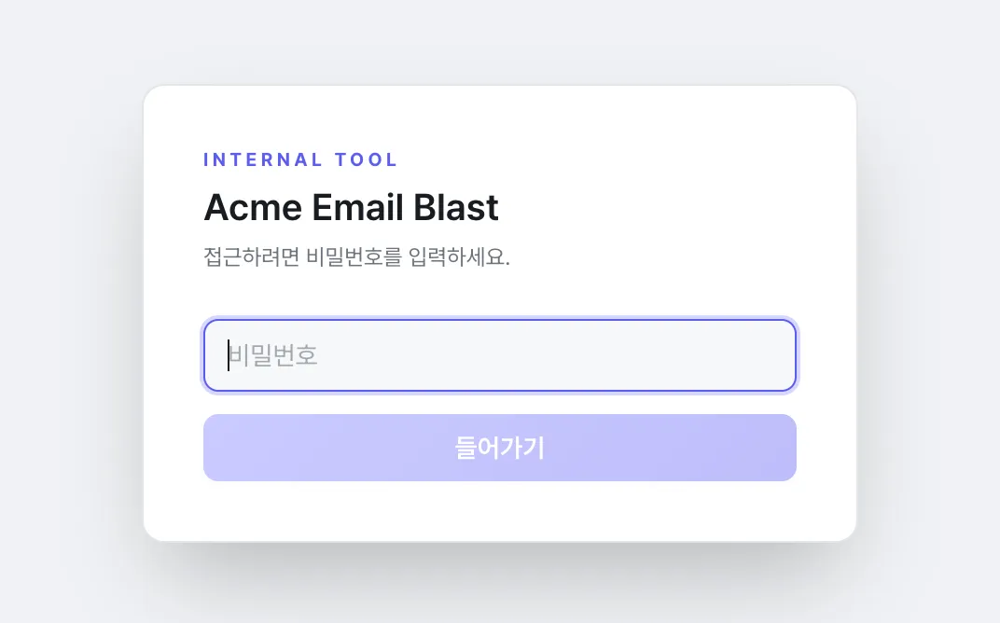

> **주의** — 예약 발송은 앱 서버 안에서 실행됩니다. ==서버가 꺼져 있던 시각의 예약은 실행되지 않습니다.== 운영 서버는 항상 켜 두고, 재시작·점검 전에는 예약 발송을 확인합니다.

---

## Resend 연결

**1.** resend.com에 가입하고 **API Keys** → **Create API Key**에서 Full access 키를 만듭니다.

**2.** **Domains** → **Add Domain**에서 발신 도메인을 추가합니다. `send.회사도메인` 같은 하위 도메인을 권장합니다. 화면에 나온 DNS 레코드(SPF·DKIM)를 도메인 DNS에 넣고 상태가 Verified가 될 때까지 기다립니다.

**3.** `.env.local`에 키를 넣고 앱을 다시 시작합니다.

```
RESEND_EMAIL_TRACKING_API_KEY=re_xxxxxxxx
```

**4.** (선택) 열람·클릭·반송을 기록하려면 Resend **Webhooks**에 `https://앱주소/api/webhooks/resend`를 등록하고, 서명 비밀값을 `.env.local`의 `RESEND_WEBHOOK_SECRET`에 넣습니다. 반송·스팸 신고 주소는 자동으로 수신거부 목록에 들어갑니다.

==도메인 인증 없이 보내면 대부분 스팸함으로 가거나 거부됩니다.==

---

## AI 연결

AI 스튜디오(채팅으로 이메일 만들기)는 Claude를 씁니다. 연결 방법은 세 가지이고, 위에서부터 먼저 쓰입니다.

| 순서 | 방법 | 어디서 |
|---|---|---|
| 1 | 설정 화면에 등록한 API 키 | **설정** → **AI** |
| 2 | `.env.local`의 `ANTHROPIC_API_KEY` | 서버 파일 |
| 3 | 서버에 로그인된 Claude CLI | 서버에서 `claude` 로그인 |

셋 다 없으면 AI 스튜디오에서 "AI 사용 불가 · 설정 → AI에서 Claude API 키 등록 필요"가 표시됩니다. AI 없이도 HTML 업로드, 발송, 리스트 등 나머지 기능은 모두 쓸 수 있습니다.

**1.** console.anthropic.com에서 API 키(`sk-ant-`로 시작)를 만듭니다.

**2.** 오른쪽 위 **프로필** → **설정** → **AI** 탭에서 키를 붙여 넣고 **저장**을 누릅니다. 관리자만 볼 수 있는 탭입니다.

**3.** **연결 확인**을 눌러 실제로 한 번 호출해 봅니다. 정상이면 어떤 방법으로 연결됐는지와 걸린 시간이 나옵니다.

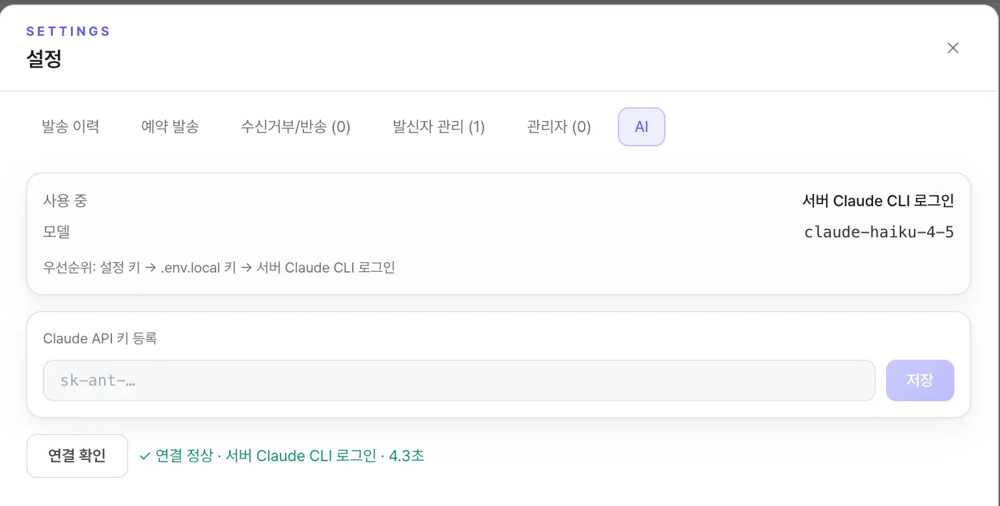

- 키는 서버의 `data/ai-settings.json`에만 저장되고 화면에는 끝 네 자리만 보입니다.
- **키 삭제**를 누르면 다음 순서(`.env.local` 키 → CLI 로그인)로 넘어갑니다.
- 모델은 `brand.config.ts`의 `ai.model`에서 바꿉니다.

---

## 화면 둘러보기

로그인하면 발송 화면이 나옵니다.

- 왼쪽: 발송 3단계 — ① 이메일 ② 수신자 ③ 발신 옵션
- 오른쪽: 선택한 이메일의 미리보기
- 오른쪽 위: **발송 이력**, **예약 발송**, **(!)** 사용 가이드, **프로필**(설정·테마·로그아웃)

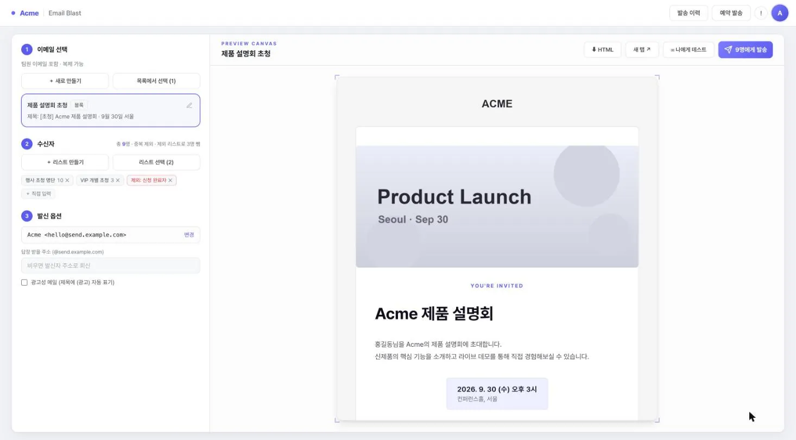

세 단계를 모두 채우면 오른쪽 위 발송 버튼이 켜집니다. 아직 못 보내는 상태면 버튼 아래에 무엇이 빠졌는지 표시됩니다.

---

## 이메일 만들기

1단계 **＋ 새로 만들기**를 누르면 두 가지 방법이 나옵니다.

- **생성** — AI 스튜디오에서 대화로 만듭니다.
- **업로드** — 완성된 HTML을 붙여 넣습니다.

### 생성 (AI 스튜디오)

화면은 세 부분입니다.

- 위쪽 한 줄: 목록 표시 이름 · 메일 제목 · 프리헤더 · **로고 ▾** · **푸터 ▾**
- 왼쪽: **AI 채팅** / **코드** 탭
- 오른쪽: 미리보기. 여기서 바로 글자를 고칠 수 있습니다.

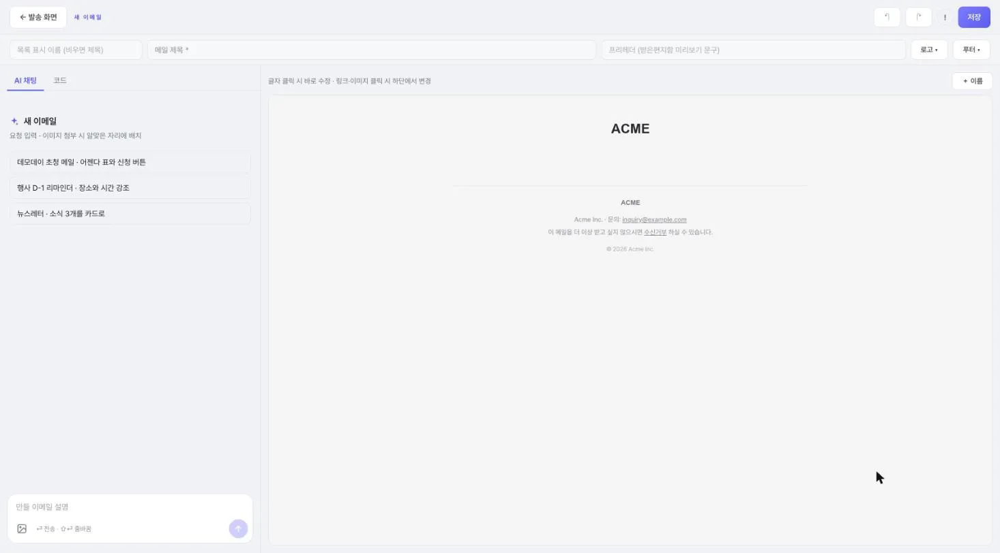

왼쪽 아래 입력창에 만들 메일을 설명하고 Enter를 누릅니다. 줄바꿈은 Shift+Enter입니다.

예: `9월 30일 서울에서 여는 제품 설명회 초청 메일. 일정 표와 신청 버튼 포함`

AI가 일하는 동안 진행 단계(요청 분석 → 이메일 작성 → 형식 검사)와 걸린 시간이 표시되고, 입력창 오른쪽 **■** 로 멈출 수 있습니다. 끝나면 바뀐 내용이 한 줄로 나오고 미리보기에서 바뀐 부분이 잠깐 강조됩니다. 그 줄 아래 **되돌리기**로 그 AI 수정만 취소합니다.

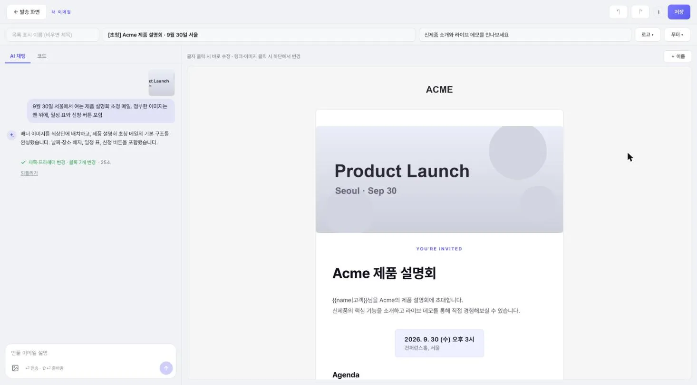

만든 뒤에도 채팅으로 계속 고칩니다(`제목을 더 짧게`, `버튼 문구만 바꿔줘`). 블록 추가·삭제·순서 바꾸기도 채팅으로 요청합니다. 색·글꼴·여백은 브랜드 설정으로 고정되어 있습니다.

==AI 대화는 저장되지 않습니다.== 스튜디오를 나가면 대화는 사라지고 이메일 작업 내용만 남습니다.

**메일 제목**을 확인하고 오른쪽 위 **저장**을 누르면 발송 화면으로 돌아가고 방금 저장한 이메일이 선택됩니다.

### 이미지 넣기

**① 채팅에 첨부**

입력창 왼쪽 이미지 버튼, 끌어다 놓기, 붙여넣기(⌘V)로 이미지를 첨부하고 요청과 함께 보냅니다. AI가 알맞은 자리에 넣습니다. 위치를 정하려면 `제목 아래에 넣어줘`처럼 함께 적습니다.

**② 미리보기에서 교체**

미리보기에서 이미지를 누르면 아래에 입력 줄이 열립니다. 이미지 주소를 붙여 넣고 **적용**을 누르거나 **파일로 교체**로 올립니다.

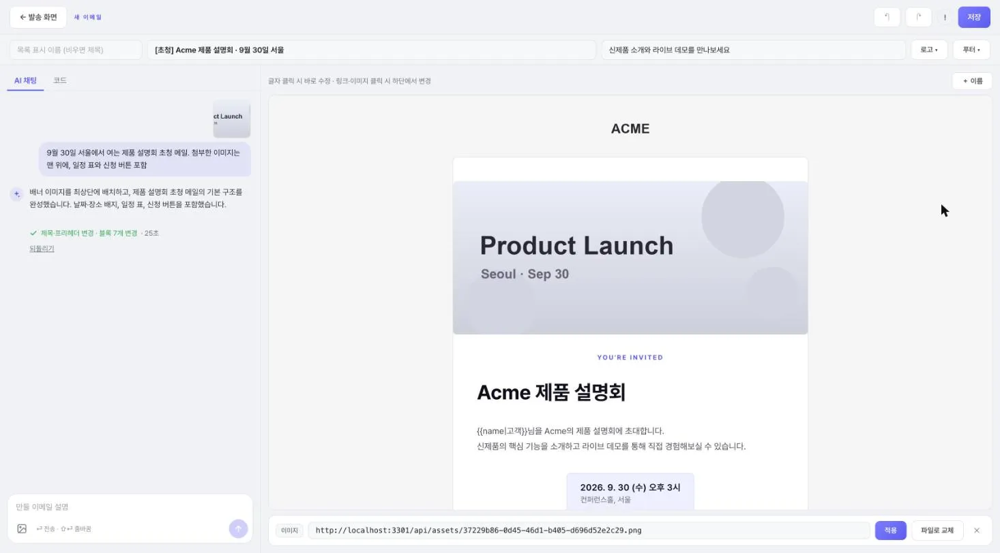

- 형식: PNG · JPG · GIF · WEBP, 한 장 5MB 이하
- 이미지는 설정에 따라 메일에 첨부되거나(기본) 공개 주소로 들어갑니다. 공개 주소 방식이면 주소를 아는 사람은 누구나 볼 수 있으니 대외비 이미지는 올리지 않습니다.

### 업로드 (HTML 직접 넣기)

완성된 HTML이 있을 때 씁니다. 메일 제목과 본문 HTML을 채우고 저장합니다. 전체 HTML 문서를 올리면 `<body>` 안쪽만 가져옵니다. HTML 안의 ``처럼 내 컴퓨터 경로로 된 이미지는 **파일 업로드**로 같은 이름의 파일을 올리면 자동으로 바뀝니다.

---

## 이메일 수정

목록에서 이메일의 **연필 아이콘**을 누르면 스튜디오가 열립니다.

### 미리보기에서 바로 고치기

- 글자: 미리보기에서 누르고 그대로 고칩니다.
- 링크·버튼·이미지: 누르면 아래 입력 줄에서 주소를 바꿉니다.
- 받는 사람 이름: 커서를 두고 오른쪽 위 **＋ 이름**을 누르면 `{{name}}`이 들어가고, 발송할 때 수신자마다 이름으로 바뀝니다. 이름이 없을 때 쓸 말은 `{{name|고객}}`처럼 적습니다.

AI가 일하는 동안에도 미리보기에서 고칠 수 있고, AI가 손대지 않은 부분의 수정은 그대로 남습니다.

### 코드 보기

왼쪽 **코드** 탭에서 HTML을 봅니다. 미리보기에서 아무 곳이나 누르면 그 부분의 코드가 표시됩니다.

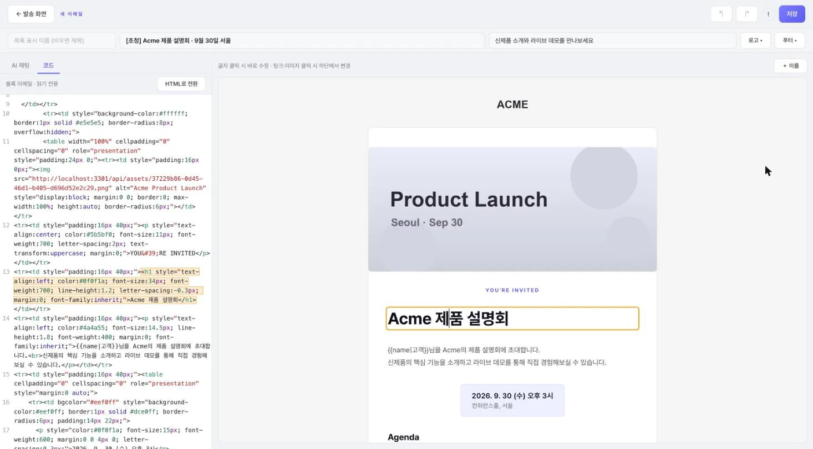

- 블록 이메일(생성으로 만든 이메일): 코드는 보기만 합니다. 직접 고치려면 **HTML로 전환**을 누릅니다. ==전환하면 블록 구조가 없어지고 HTML 이메일이 됩니다.==
- HTML 이메일(업로드로 만든 이메일): 코드를 직접 고칠 수 있고, 코드와 미리보기가 서로 바로 반영됩니다.

### 되돌리기

위쪽 **↶** **↷** 또는 ⌘Z / ⇧⌘Z. 손 수정은 블록(HTML 이메일은 글 한 덩어리) 단위로, AI 수정은 한 번에 되돌립니다. 기록은 스튜디오를 나가면 사라집니다.

### 제목·프리헤더·로고·푸터

- 목록 표시 이름: 목록에서 보이는 이름. 비우면 제목이 쓰입니다.
- 프리헤더: 받은편지함에서 제목 옆에 보이는 짧은 문구
- **로고 ▾**: 로고 종류, 표시 여부, 로고 아래 한 줄 (블록 이메일만)
- **푸터 ▾**: 소셜 아이콘·회사명·문의·수신거부 링크 켜기/끄기, 문의 이메일 (블록 이메일만)

### 저장과 임시 저장

**저장**을 눌러야 반영됩니다. 저장하지 않고 나가도 작업은 이 브라우저에 임시 저장되어 다시 열면 **이어서 하기** / **버리기**가 나옵니다.

이 이메일로 내가 걸어 둔 예약 발송이 있으면 저장할 때 묻습니다. **확인**은 예약 내용도 새 내용으로 바꾸고, **이메일만 수정**은 예약을 예약할 때 내용 그대로 둡니다.

---

## 이메일 선택

1단계 **목록에서 선택**을 누르면 전체 이메일이 나옵니다. 굵은 글씨가 목록 이름, 그 아래가 받는 사람에게 보이는 제목입니다.

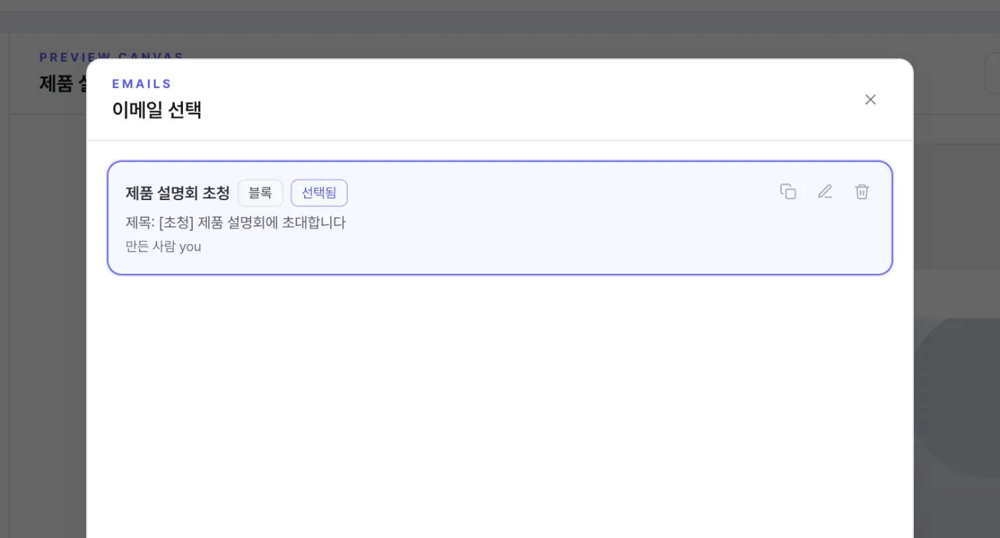

- **복사** — 복제해서 새 이메일 만들기(누구나). 제목·문구만 조금 바꿔 다시 보낼 때 씁니다.
- **연필** — 스튜디오에서 편집
- **휴지통** — 영구 삭제. 만든 사람과 관리자만, 복구 불가

미리보기 위 **나에게 테스트**로 내 주소에 시험 발송합니다.

---

## 수신자 리스트

리스트와 직접 입력을 함께 쓸 수 있고, 겹치는 주소는 한 번만 갑니다.

### 리스트 선택

2단계 **리스트 선택**에서 여러 리스트를 고릅니다. 각 줄 **제외**를 누르면 그 리스트에 있는 사람은 이번 발송에서 빠집니다. 예: '초청 명단'을 고르고 '신청 완료자'를 제외하면 아직 신청하지 않은 사람에게만 갑니다.

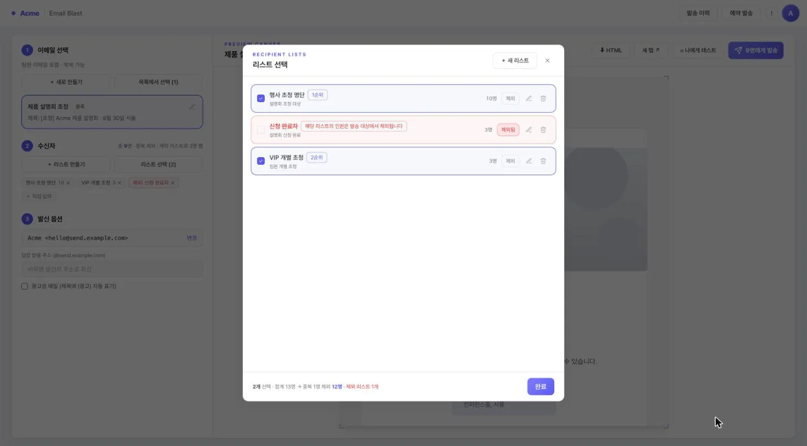

### 리스트 만들기·수정

**＋ 새 리스트** 또는 각 줄의 **연필**을 누릅니다. 멤버는 두 가지로 넣습니다.

**① 붙여넣기**

엑셀이나 메모장에서 복사한 내용을 그대로 붙여 넣습니다.

```
홍길동 gildong@example.com
김철수, chulsoo@example.com
이영희 <younghee@example.com>
```

**② CSV/Excel 업로드**

첫 줄에 `email` 또는 `이메일` 열이 있어야 합니다. 이름(`name`·`이름`·`성함`), 회사(`company`·`회사`·`소속`), 직함(`title`·`직함`·`직책`) 열도 함께 들어갑니다.

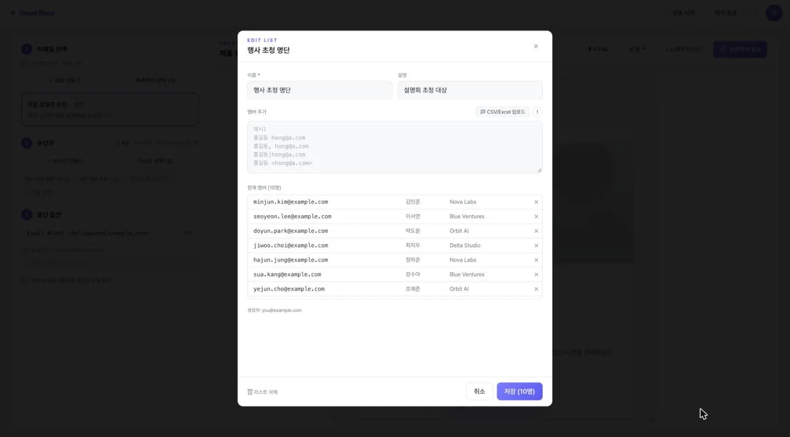

==멤버 추가는 누구나 할 수 있습니다.== 이름 변경, 멤버 삭제, 리스트 삭제는 만든 사람과 관리자만 합니다. 이 리스트를 쓰는 예약 발송이 있으면 저장할 때 **확인**(예약 명단도 갱신) / **리스트만 수정** / **취소** 중에서 고릅니다.

### 직접 입력

몇 명에게만 보낼 때는 **＋ 직접 입력**을 씁니다. 다음에도 쓸 명단이면 **리스트로 저장**을 누릅니다.

---

## 발신 옵션

- **공용 발신자로** — 등록된 회사 주소로 보냅니다. **변경**으로 고르고, 추가·삭제는 관리자가 설정에서 합니다.
- **내 계정으로** — 내 회사 주소로 보냅니다(Google 로그인 방식에서만).
- **답장 받을 주소** — 비우면 발신 주소로 답장이 갑니다.
- **광고성 메일** — 체크하면 제목 앞에 `(광고)`가 붙고, 본문에 수신거부 링크가 없으면 맨 아래에 수신거부 문구가 자동으로 붙습니다.

---

## 미리보기와 발송

발송 버튼을 누르면 ==최종 확인 화면==이 먼저 나옵니다.

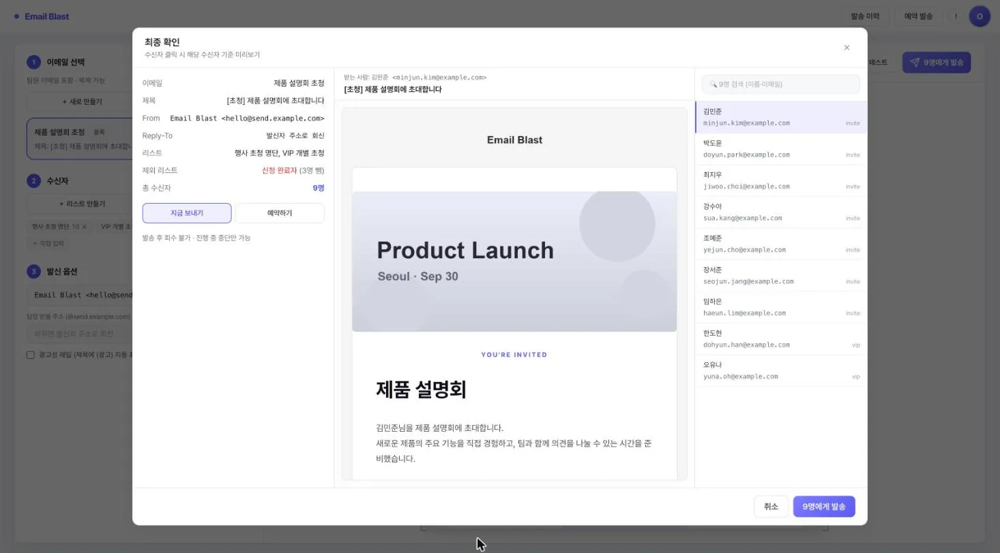

- 왼쪽 — 이메일, 제목, 발신, 리스트, 제외 리스트, 총 인원, 재발송 대상, 지금 보내기 / 예약하기
- 가운데 — 선택한 수신자 기준으로 `{{name}}`이 실제 이름으로 바뀐 완성본
- 오른쪽 — 수신자 목록. 한 명을 누르면 그 사람에게 갈 화면이 가운데에 나옵니다.

같은 이메일을 이미 받은 사람이 섞여 있으면 발송 버튼을 누를 때 창이 뜹니다.

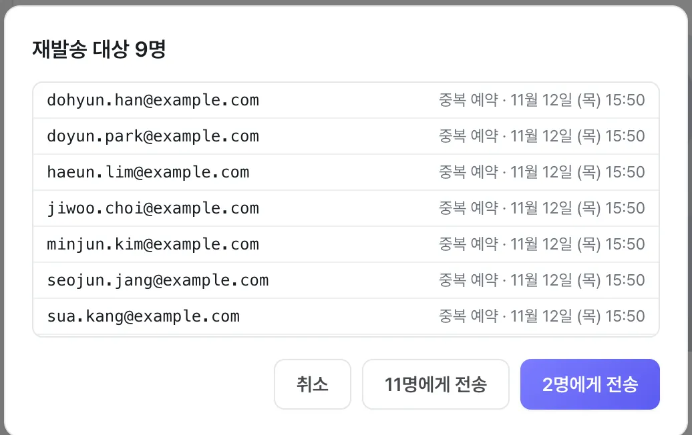

- **취소** — 돌아가서 다시 고릅니다.
- **N명에게 전송** — 이미 받은 사람까지 모두에게 보냅니다(리마인더·정정 메일).
- **M명에게 전송** — 처음 받는 사람에게만 보냅니다.

> **주의** — 발송한 메일은 회수할 수 없습니다. 발송 중 중단은 되지만 이미 나간 메일은 취소되지 않습니다. 큰 리스트로 보내기 전에 **나에게 테스트**로 확인합니다.

---

## 예약 발송

최종 확인 화면에서 **예약하기**를 누르고 날짜와 시간을 고릅니다. 시간은 입력칸 옆에 표시된 시간대 기준입니다(기본 KST, `brand.config.ts`의 `schedule`에서 바꿈).

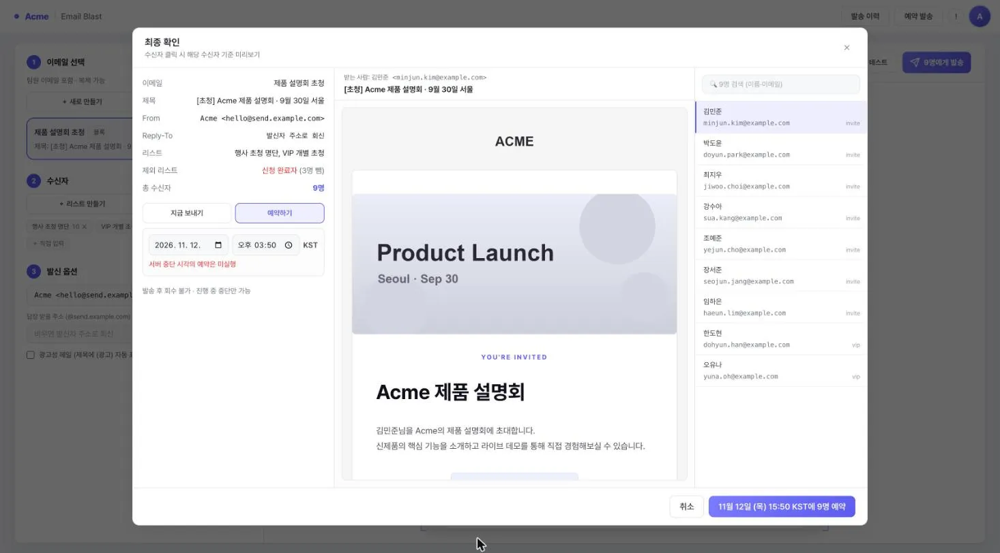

- 예약할 때의 내용과 명단 그대로 나갑니다. 이메일이나 리스트를 고쳐 저장하면 내 예약에도 반영할지 묻습니다.
- 수신거부와 발송 한도는 보내는 순간에 다시 확인합니다. 한도를 넘는 인원은 보내지 않고 표시합니다.

오른쪽 위 **예약 발송**에서 예약을 관리합니다. 확인할 문제가 있으면 빨간 점이 붙습니다.

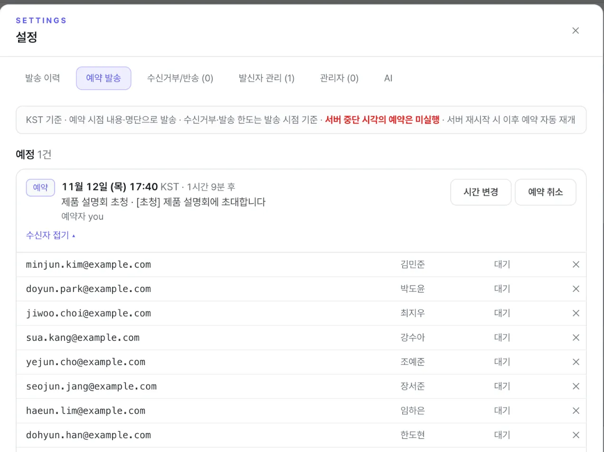

- 예정 — **시간 변경**, **예약 취소**, 수신자를 펼쳐 사람별로 빼기
- 지난 예약(30일) — 완료 / 일부 발송 / 미실행 / 취소. 보내지 못한 사람은 **미발송자 다시 보내기**로 발송 화면에 채웁니다.

---

## 설정

오른쪽 위 **프로필** → **설정**. 같은 메뉴에서 다크 모드와 로그아웃을 합니다.

### 발송 이력

발송 내역이 최신순으로 나옵니다. 카드를 누르면 수신자별 상태(전달·열람·반송 등)를 보고, **실패자 재발송**, **리마인더**, **미발송자 이어 보내기**로 대상만 골라 발송 화면에 채울 수 있습니다.

### 수신거부/반송

수신거부, 반송, 스팸 신고 주소가 모이며 ==다음 발송에서 자동으로 빠집니다.== 메일·전화로 받은 요청은 직접 추가합니다. 해제는 관리자만 합니다.

### 발신자 관리 · 관리자 · AI (관리자)

- 발신자 관리 — 공용 발신 주소 추가·삭제. 인증한 발신 도메인 주소만 됩니다.
- 관리자 — 관리자 추가·삭제(Google 로그인 방식)
- AI — Claude API 키 등록과 연결 확인 ("AI 연결" 참고)
